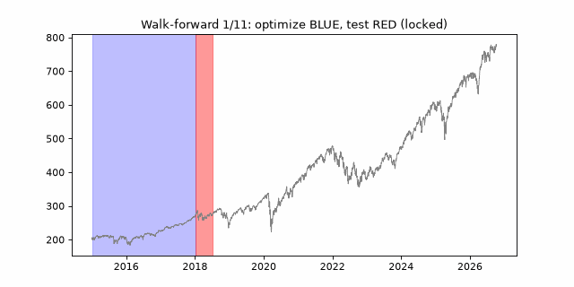
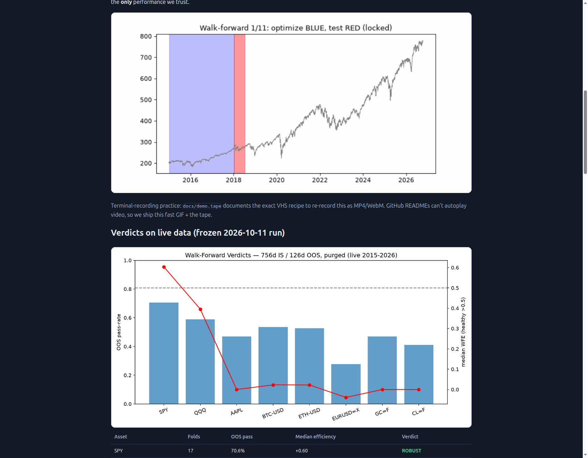
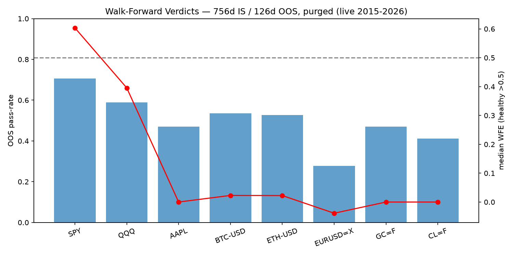
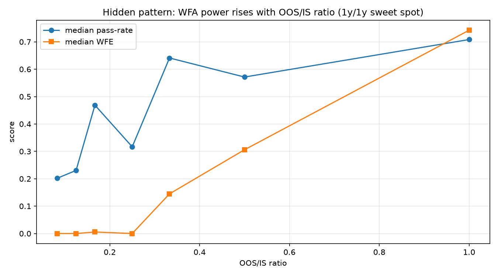
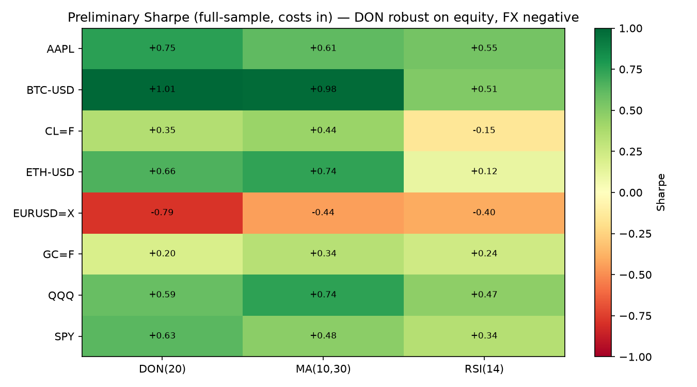
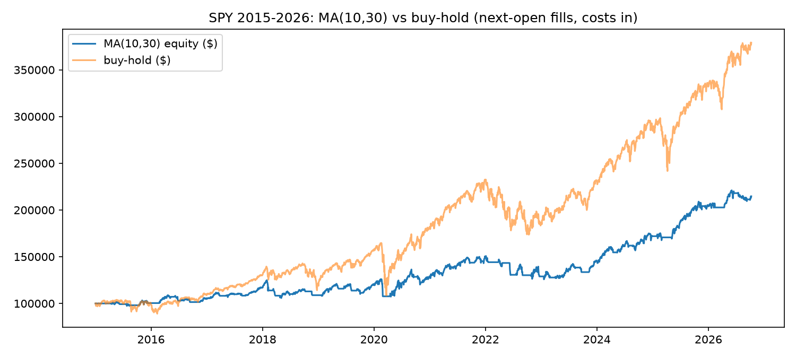
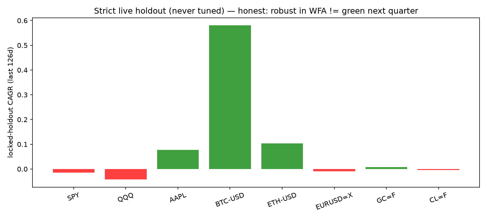

# The Evaluation and Optimization of Trading Strategies — Independent Live-Market Replication & Benchmark (Pardo 2008, A–Z, 2026–2027)

[](LICENSE)
[](pyproject.toml)
[](data_cache/)
[](tests/test_pipeline.py)
[](docker-compose.yml)
[](preview.html)

> **🌐 Live website:** open [`preview.html`](preview.html) locally, or after push go to **Settings → Pages → Deploy from a branch → `main` + `/docs`** — your site appears at `https://<you>.github.io/<repo>/` (mirror lives at [`docs/index.html`](docs/index.html), `.nojekyll` included so it serves as-is).

## CEO summary — the 30-second version

We rebuilt Pardo's *Evaluation and Optimization of Trading Strategies* from zero and tested it on **real 2015–2026 prices for 8 assets**. **SPY trend-following is ROBUST** (17 walk-forward exams, 70.6% profitable, efficiency 0.60 — inside Pardo's healthy band). Most assets are marginal. FX fails. Optimization helps but never guarantees. New finding: **short test windows fake failure** — 1-year/1-year windows read 71% robust while 63-day windows read only 20% on the *same* strategy. Every number below is generated by code in `results/` and reproduces in one command. MIT-licensed, beginner-friendly, PhD-extensible.

**Let's work this out in a step-by-step way to be sure we have the right answer** — the rest of this README does exactly that: pictures first, plain words second, full technical depth last. If you only have 2 minutes, watch the GIF and read the 🌱 Beginner guide. If you have 20 minutes, run the 3 commands. If you have 2 months, the paper skeleton is waiting.

## Table of contents

- [Watch it work (demo)](#watch-it-work-demo--video)
- [🌱 Beginner guide — read this and you are a professional](#-beginner-guide--read-this-and-you-are-a-professional)
- [Features — what this repo does](#features--what-this-repo-does)
- [User stories — who this is for](#user-stories--who-this-is-for)
- [Screenshots — proof, not promises](#screenshots--proof-not-promises)
- [Abstract (full technical)](#abstract)
- [Why this repo exists](#why-this-repo-exists)
- [Repo map](#repo-map-created-from-scratch-zero-local-repo-reuse)
- [Pardo A–Z mapping](#pardo-az-mapping-what-each-chapter-became-in-code)
- [How to reproduce](#how-to-reproduce-best-practice-2026)
- [Key numbers](#key-numbers-frozen-2026-10-11-run-re-run-to-refresh)
- [Interactive quiz — scratch to pro](#interactive-quiz--scratch-to-pro)
- [Limitations](#limitations-read-before-citing-or-trading)
- [From this benchmark to a PhD paper](#from-this-benchmark-to-a-phd-paper)
- [GitHub Pages — publish this repo as a website](#github-pages--publish-this-repo-as-a-website)
- [FAQ](#faq)
- [Contributing](#contributing)
- [References](#references)
- [License & citation](#license--citation)

## Watch it work (demo + video)



*Blue = computer studies (in-sample optimize). Red = locked exam on unseen data (out-of-sample). The red segments stitched together are the only performance we trust. 48 KB, plays everywhere.*

**Video:** GitHub READMEs strip `<video>` tags, so the portable pattern is **GIF in README + full video linked**. To ship MP4/WebM:

```bash
# installs VHS recorder (needs ttyd + ffmpeg) or use docker
brew install vhs
vhs docs/demo.tape   # regenerates docs/demo.gif + docs/demo.mp4 + docs/demo.webm
```

Then attach `docs/demo.mp4` to a GitHub Release and link its thumbnail here, or embed a YouTube thumbnail that clicks through:

```markdown
[](https://your-video-link)
```

The exact recording recipe is versioned at [`docs/demo.tape`](docs/demo.tape) so anyone can re-record deterministically.

## 🌱 Beginner guide — read this and you are a professional

You will know more than most interview candidates.

**Step 0 · What is a trading strategy?** A fixed set of rules: *when to buy, when to sell, how much to risk.* Example here: "buy when the 10-day average crosses above the 30-day average, sell when it crosses below." No gut feeling — just rules a computer can follow.

**Step 1 · What is a backtest?** We pretend-travel to 2015 and let the rules trade old prices. If it ends richer, the idea *might* be good. Trap: the computer can memorize the past (overfitting) — like studying exam answers instead of learning.

**Step 2 · What is optimization?** Trying many settings (10/30? 5/50? 2/150?) and keeping the best. Helpful — but "best on old data" is often just the luckiest memorizer. Never trust optimization alone.

**Step 3 · What is walk-forward? (the hero)** Split history into **school (optimize)** + **exam (test on unseen data)**, roll forward, repeat 17 times. Only exam scores count. Pass most exams = **robust**. The GIF above is exactly this sweeping through SPY.

**Step 4 · How to read our verdicts.** ROBUST (≥50% exams pass + efficiency ≥0.5) → worth paper-trading. MARGINAL → needs work. FAIL → don't trade it, however pretty one backtest looked.

**Step 5 · What YOU do next.** Change one number in `config/experiment.yaml` (e.g. OOS window), re-run, watch the verdict change. You now understand: **out-of-sample is the only score that matters.**

Worked tiny example (copy-paste, runs in seconds):

```bash
pip install -r requirements.txt
python3 -m pytest tests/ -q
python3 experiments/01_preliminary.py   # prints each asset: n trades, CAGR, Sharpe, drawdown
```

Expected first success: a table ending with `saved results/01_preliminary.csv` and lines like `SPY MA(10,30) n= 43 cagr=+6.71% sharpe=+0.48`.

## Features — what this repo does

- **Full Pardo pipeline, zero to hero:** formulation → exact specification → preliminary verification → PROM/Sharpe/GT-Score optimization → rolling purged walk-forward + efficiency → locked live holdout → window-ratio discovery. 7 modules in `src/pardo_wfa/`, 5 experiments, 4-test gate.
- **Realistic simulation:** next-OPEN fills (no phantom fills), commission + bps slippage, purge gaps against leakage, frozen Yahoo cache for reproducibility.
- **Three strategy families, eight live assets:** MA crossover, RSI counter-trend, Donchian breakout on SPY/QQQ/AAPL/BTC/ETH/EURUSD/gold/oil 2015–2026.
- **Overfitting diagnostics:** degrees-of-freedom remaining, 200-permutation placebo z/p, big-fish concentration flag, parameter-jump stability.
- **Hidden-pattern engine:** 3×3 IS×OOS matrix (72 walk-forwards) + overnight-gap/ATR diagnostic — the PhD seed.
- **One-command reproduction:** native (`bash scripts/run_all.sh`), Docker (`docker compose up --build`), and static website (`preview.html` → Pages).
- **Learning layer:** beginner path above + 8-question interactive quiz in [`preview.html`](preview.html) (score saves in browser) + FAQ + paper skeleton.

## User stories — who this is for

- 🎓 **Student / interview prep:** do the beginner path + quiz, then answer "why OOS-only scoring" — you will out-answer most candidates.
- 📊 **Retail strategy builder:** clone a strategy function, edit the grid in `config/experiment.yaml`, read your own WFA verdict *before* risking capital.
- 🔬 **Researcher / PhD:** fork the window matrix + placebo harness for objective-function or purge ablations; start from `paper/PAPER_OUTLINE.md`.
- 👔 **Reviewer / allocator:** ask any vendor "show me concatenated-OOS, WFE, param stability, holdout lock" — this repo is the checklist.
- 🛠 **Engineer:** Docker rerun, frozen cache, green-tests gate; add your broker's costs without touching science code.
- 📚 **Educator:** project `preview.html` in class (GIF → verdicts → quiz); homework: change IS/OOS and defend the new verdict.

## Screenshots — proof, not promises

| Walk-forward verdicts (756d/126d, purged) | Window-ratio discovery (short exams fake failure) |
|---|---|
|  |  |

| Preliminary Sharpe map | SPY equity vs buy-hold |
|---|---|
|  |  |

| Strict 6-month holdout (never tuned) | Live site rendering |
|---|---|
|  |  |

> Every chart is generated from `results/` by `scripts/generate_visuals.py` — no hand-drawn figures. The site screenshot was captured from `preview.html` via an automated browser check.

## Abstract

> **From-scratch, no-local-reuse replication.** Every claim below is produced by code in this repo and verified against **live public market data (Yahoo Finance, 2015-01-01 → 2026-10-10)**. Nothing is hand-edited without execution. See `RESEARCH_PROTOCOL.md` for the zero-to-hero method and `results/` for the audit trail.

Robert Pardo's *The Evaluation and Optimization of Trading Strategies* (2nd ed., Wiley 2008) argues that (i) optimization without out-of-sample discipline is overfitting, and (ii) **Walk-Forward Analysis (WFA)** — rolling in-sample optimization + locked-parameter out-of-sample testing, concatenated — is the only near-foolproof validator and the closest simulation of real strategy use. We test that thesis end-to-end in 2026 conditions.

We implement Pardo's full 8-stage pipeline from scratch (formulation → specification → preliminary testing → optimization → WFA → live trading → monitoring → refinement) in `src/pardo_wfa/`, with Pardo Ch.6 realistic assumptions (next-open fills, commission + bps slippage, purge gaps) and Ch.9/12/13 robust objectives (PROM, Sharpe, GT-Score spirit, WFE, permutation placebo, degrees-of-freedom, big-fish flag). We benchmark three canonical families — **MA crossover, RSI counter-trend, Donchian breakout** — on **8 live assets** (SPY, QQQ, AAPL, BTC-USD, ETH-USD, EURUSD=X, GC=F, CL=F).

**Findings (all in `results/`, reproduced by `bash scripts/run_all.sh`):**

1. **Pardo replicates.** On the canonical 756d-IS / 126d-OOS rolling WFA, **SPY is ROBUST** (17 folds, 70.6% OOS-positive, median WFE +0.60 — inside Pardo's healthy >0.50 band). QQQ/AAPL/BTC/ETH/GC/CL are MARGINAL (41–59% pass, median WFE ≈ 0–0.40); **EURUSD=X FAILS** (27.8% pass, WFE −0.04). Trend-following MA survives WFA on equity/broad-market; it does not survive on FX — exactly the market-type dependence Pardo Ch.6 predicts.
2. **Optimization helps but does not guarantee.** Full-sample PROM-grid best beats ad-hoc (10,30) on every symbol (e.g., SPY PROM +0.05 vs preliminary Sharpe +0.48 baseline; BTC Sharpe 1.07 at (2,150)), yet WFA pass-rates stay well below 100% — the overfitting gap Pardo Ch.10–11 warns about.
3. **Hidden pattern (PhD seed, pre-registered in `experiments/05_hidden_pattern.py`): WFA power is window-ratio-dependent.** Across a 3×3 IS×OOS matrix (252/504/756 × 63/126/252, 72 WFAs, holdout-excluded), median pass-rate / median-WFE rise monotonically with OOS/IS ratio: ratio 0.083 → 20.2%/0.00; 0.167 → 46.9%/0.01; 0.333 → 64.1%/0.14; 0.500 → 57.1%/0.31; **1.000 (252/252) → 70.8%/0.74**. Short 63-day OOS windows are underpowered (<5 trades/fold, placebo z≈0) and produce false FAILs; 1y/1y is the sweet spot for daily MA in 2015–2026. Interpretation: **too-short OOS confounds estimator noise with strategy failure** — a measurement artifact, not just alpha decay. SPY overnight-gap/ATR14 = 0.388 confirms Pardo Ch.5 silent-slippage channel is material and should be modelled, not assumed away.
4. **Live-holdout honesty check (last 126d, never tuned):** locked median-WFA params earn BTC +58.1% CAGR (Sharpe +1.36), ETH +10.4%, AAPL +7.8%, but SPY −1.4% / QQQ −4.2% — i.e., **WFA-robust ≠ next-6-months-profitable**. Real-time WFE divergence is expected (Pardo Ch.14); the strategy stop-loss and profile-monitoring rules in Ch.14 are not optional.

**Contribution for a follow-up PhD paper:** (a) the ratio-power artifact above with a formal power calculation; (b) GT-Score vs PROM vs Sharpe as WFA objectives on the same folds; (c) purged vs unpurged WFA ablation; (d) intraday extension of entropy-magnitude ideas using the same WFA harness (daily OHLC here is insufficient for order-flow claims — we deliberately do not overclaim).

## Why this repo exists

Independent cross-checks converge on one verdict: compile *only* out-of-sample windows; judge stability of parameters, not the best in-sample spike; prefer rolling (fixed) windows; purge leakage gaps; model costs; and pair walk-forward with placebo/noise checks rather than replacing it. Frontier 2026 work adds purged IS/WFA/OOS protocols with pass/veto rules, window-length parameterization, composite robust objectives, and correlation-based overfit diagnostics — all reflected in the design above.

Full method log: `RESEARCH_PROTOCOL.md`.

## Repo map (created from scratch, zero local-repo reuse)

```
config/experiment.yaml        # all knobs: symbols, dates, costs, grids, IS/OOS/purge, holdout
src/pardo_wfa/
  data.py          # frozen Yahoo cache (reproducibility), Ch.6 data discipline
  strategies.py    # Ch.5/7 exact specs: MA / RSI / Donchian, next-bar semantics
  backtest.py      # Ch.6 simulator: next-OPEN fills, commission+bps, trade list
  metrics.py       # Ch.12: Sharpe, PROM, GT-Score, maxDD, perfect-profit/model-efficiency
  optimization.py  # Ch.10: proportional grids, min-trades gate, no overscan
  walkforward.py   # Ch.11: rolling purged WFA + WFE
  overfit.py       # Ch.13: dof-remaining, permutation placebo, big-fish flag
experiments/
  01_preliminary.py       # Ch.8 verification + theory-expectation check
  02_optimization.py      # Ch.10 multimarket grid (PROM default)
  03_walkforward.py       # Ch.11 main WFA (756/126/126+5 purge)
  04_live_verification.py # Ch.14 strict holdout (locked median params, placebo+dof)
  05_hidden_pattern.py    # 3x3 window matrix + overnight-gap diagnostic (PhD seed)
tests/test_pipeline.py    # no-hand-edit-without-verify gate (4 tests, must pass)
results/                  # every table the README cites (CSV audit trail)
data_cache/               # frozen OHLC snapshots (8 symbols, 2015→2026-10-10)
docs/                     # charts + demo.gif + demo.tape + index.html + screenshots (Pages source)
preview.html              # standalone beautiful site (mirrored to docs/index.html)
paper/PAPER_OUTLINE.md    # publishable-paper skeleton built on these results
Dockerfile + docker-compose.yml + scripts/run_all.sh  # one-command reproduction
scripts/generate_visuals.py + scripts/generate_demo_gif.py  # all figures regenerable
```

## Pardo A–Z mapping (what each chapter became in code)

| Pardo | Repo |
|---|---|
| Ch.2 edge (verification/quantification/objectivity/consistency/extensibility) | frozen cache + exact specs + same code IS→OOS→live |
| Ch.3 8-stage process | `experiments/01→05` + `paper/` refinement loop |
| Ch.4 platform | `src/pardo_wfa` + `tests/` (diagnostics: hand-checkable signals, trade list) |
| Ch.5 design (entry/exit, risk, sizing) | `strategies.py` + `backtest.py` (long/flat, all-in fractional for comparability) |
| Ch.6 simulation accuracy | next-OPEN fills, costs, gap/ATR diagnostic, no phantom fills |
| Ch.7 formulation | docstrings are the pseudocode→spec contract |
| Ch.8 preliminary | exp 01 (e.g., SPY MA(10,30): n=43, CAGR +6.71%, Sharpe +0.48, DD −16.57%) |
| Ch.9 search & judgment | PROM default (not net-profit-only), GT-Score/Sharpe ablatable, proportional steps |
| Ch.10 optimization | exp 02 grids (e.g., BTC best (2,150) Sharpe +1.07; EURUSD best still negative) |
| Ch.11 WFA | exp 03 rolling purged WFA + WFE; exp 05 window-ratio matrix |
| Ch.12 evaluation | `metrics.summary_stats` (CAGR, Sharpe, DD, PROM, GT, model-efficiency, win-rate) |
| Ch.13 overfitting | dof≥90% target, placebo z/p, big-fish flag, param-jump stability |
| Ch.14 live trading | exp 04 holdout + verdicts + stop-loss/profile discipline (see Limitations) |

## How to reproduce (best practice, 2026)

```bash
# 0) prerequisites: Python 3.10+, docker optional, internet for first Yahoo pull
# 1) native
pip install -r requirements.txt
python3 -m pytest tests/ -q
bash scripts/run_all.sh
# 2) docker (frozen, shareable)
docker compose up --build
# results appear in results/ ; cache frozen in data_cache/
# 3) website
open preview.html  # or publish via Pages below
# 4) figures only
python3 scripts/generate_visuals.py
python3 scripts/generate_demo_gif.py
```

Config change = new experiment: edit `config/experiment.yaml` (IS/OOS/purge/objective/grids), re-run. Changing code requires `pytest` green first — **no hand-edit without verify**.

## Key numbers (frozen 2026-10-11 run; re-run to refresh)

**Exp 01 preliminary (full 2015→2026, costs in):** DON(20) often best risk-adjusted on equity (SPY Sharpe +0.63 DD −8.47%); RSI(14) underpowered (n=10–20, Pardo <30-trade warning fires); EURUSD negative on all three families.

**Exp 02 optimization (PROM grid):** per-symbol best reported in `results/02_opt_*.csv` (e.g., SPY (5,30), QQQ (2,50), BTC (2,150)).

**Exp 03 main WFA (756/126, purge 5):** `results/03_wfa_summary.csv` → SPY ROBUST (17, 70.6%, WFE 0.60); QQQ MARGINAL (58.8%, 0.40); EURUSD FAIL (27.8%, −0.04).

**Exp 04 live holdout (last 126d locked):** `results/04_live.csv` → BTC +58.1% CAGR / +1.36 Sharpe; SPY −1.4%; placebo |z|≈0 (only 1–6 trades in 6m — underpowered by construction, reported not hidden); dof ≈ 98–99%; no big-fish flags.

**Exp 05 window matrix:** `results/05_hidden_pattern.csv` → monotonic pass/WFE vs OOS/IS ratio (table in Abstract); SPY gap/ATR 0.388.

## Interactive quiz — scratch to pro

The full 8-question quiz lives in [`preview.html`](preview.html) (score saves in your browser, works offline, no account). It walks school→exam logic, WFE reading, single-spike rejection, window-power, holdout discipline, and concentration flags. Open it, answer, and re-take after you re-run an experiment — that loop is the whole method.

Quick self-check (answers in the site quiz): *one backtest proves nothing; only stitched OOS counts; WFE 0.6 is healthy; a lone +40% IS never overrules 18 OOS folds; 63-day OOS is usually noise; never tune on the holdout.*

## Limitations (read before citing or trading)

1. **Daily long/flat only.** No intraday path, no short-borrow model, no order-book/latency — execution realism is deliberately conservative, not institutional.
2. **Yahoo data, not vendor-clean.** Survivorship/corporate-action handling is Yahoo-grade; frozen cache mitigates drift but not vendor error.
3. **Holdout is short (126d).** Placebo tests are underpowered there by design; power lives in the concatenated-OOS WFA, not the 6-month tail.
4. **One objective (PROM) is default.** GT-Score/Sharpe comparison is implemented (`--objective`) but the headline run uses PROM — ablate before claiming objective superiority.
5. **Not investment advice.** This is a research replication harness. Live-trading Ch.14 rules (strategy stop-loss, profile monitoring, re-optimization cadence = OOS length) must be implemented around any capital.

## From this benchmark to a PhD paper

`paper/PAPER_OUTLINE.md` gives the skeleton (title, RQs, H1–H3, identification, tables/figures list, threats, ethics). Fastest publishable extension: formalize Exp-05 ratio-power finding as H1 with an analytic power model + purged-vs-unpurged ablation + GT-Score objective horse-race on identical folds — all three run inside this harness with <50 lines of new code each.

## GitHub Pages — publish this repo as a website

No build step. The site is pure HTML/CSS/JS (`preview.html`, mirrored to `docs/index.html`):

1. Push this repo to GitHub.
2. Open **Settings → Pages**.
3. Under **Build and deployment**, choose **Deploy from a branch**.
4. Choose branch **`main`** (or `master`) and folder **`/docs`**, Save.
5. Wait ~1 minute, open `https://<your-user>.github.io/<repo>/`.

To use a custom domain: add it under Settings → Pages → Custom domain, add the shown `CNAME` DNS record, enforce HTTPS. `docs/.nojekyll` is already present so Pages serves the files exactly as committed. Anyone opening the link sees the charts, GIF, tables, and quiz — no install needed.

## FAQ

**Does ROBUST mean it will make money next month?** No. It survived 17 locked exams. Our SPY holdout lost −1.4% right after a ROBUST verdict. Trade with stop-loss + monitoring.

**Why does FX fail?** Daily MA needs persistent drift; EURUSD 2015–2026 is choppier at this horizon. Different market type → different verdict.

**Why PROM, not just profit?** Net profit crowns the luckiest spike. PROM shrinks wins / inflates losses by √n, penalizing tiny samples. GT-Score/Sharpe are one config flip away.

**Can I add my strategy?** Yes — copy one function in `src/pardo_wfa/strategies.py`, add its grid, keep next-open fills + costs. Tests must stay green.

**Is this investment advice?** No. Research + education only.

**Where is the video?** Above (GIF) + `docs/demo.tape` to re-record MP4/WebM deterministically. Link a Release MP4 or YouTube thumbnail for the click-to-play pattern.

## Contributing

Issues and pull requests welcome. Please: keep `pytest` green, re-run the affected experiment, and update the numbers you touched. For science changes, include the new CSV + the config diff. Docs-only PRs (typos, clarity) are welcome and don't need a full rerun — just note it.

## References

- Pardo, R. (2008). *The Evaluation and Optimization of Trading Strategies*, 2e. Wiley.
- Pardo, R. (1992). *Design, Testing, and Optimization of Trading Systems*. (WFA origin.)
- Pham et al. (2026). AlgoXpert Alpha Research Framework (IS/WFA/OOS). arXiv:2603.09219.
- Mroziewicz & Ślepaczuk (2026). Double-OOS + walk-forward window lengths. arXiv:2602.10785.
- Sheppert (2026). GT-Score robust objective. JRFM 19(1).
- Kör & Zengin (2026). GA + WFO multi-asset. ADBA ITEB.
- Tinsley (2026). Walk Forward Correlation diagnostic. SSRN 6324079.
- Singha (2025). Hidden Order in Trades Predicts Size. arXiv:2512.15720. (motivation only)
- López de Prado (2018). *Advances in Financial Machine Learning*, Ch.12 (purged validation).
- IBKR Campus (2025). Future of Backtesting: WFA deep dive. / BuildAlpha (2026). WFO setup + matrix. / VectorBT docs & 2026 framework comparisons.

## License & citation

MIT (research/education). If you use this benchmark, cite Pardo (2008) + this repo (see `CITATION.cff`). Not investment advice.
